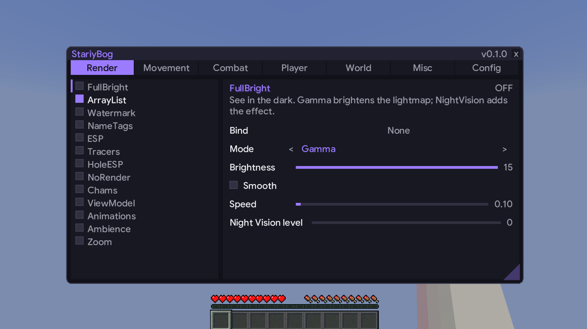

# StariyBog, Horizon hack client

.png)

# THIS PROJECT IS COMPLETELY VIBE CODED, using opencode, qoder and workbuddy, using models like deepseek 4.1 flash and HY4. THIS CLIENT (probably) will not be updated, issue will not be resolved.

This was originally a personal project. But I decided to abandoned it because the storage is tight, and I don't have fun making it. Go and paste this client.

Screenshot of the UI



Original description:

A Right Shift module menu for Horizon with tabbed categories. The first tab is **Render**, with **FullBright**
(see in the dark with a gamma ramp or a night vision effect), **ArrayList** (the enabled modules in the top-right
corner while playing), **Watermark** (your name, FPS and ping in a corner you pick), **Zoom** (hold a key to zoom
in; the wheel changes the zoom while it is held), **HoleESP** (highlights the sealed obsidian and bedrock holes
around you), **Chams** (entity bodies through walls, as filled figures or the game's own glow outline),
**ViewModel** (move, turn and resize the first-person hands and the items in them), **Animations**
(the swing's speed, how far it travels, and whether an item comes to the mouth), **Ambience** (the time of day,
the weather, and the colour and reach of the fog) and
**NoRender** (stops the HUD elements, fog, name tags, glowing outlines, particles, the first-person
hand and mob models you pick from drawing), all with editable settings. The **Player** tab has **AutoTool**
(switch to the best tool for the block you mine, and back); the
**Combat** tab has **AutoWeapon** (switch to the best hotbar weapon when you attack or aim at an entity); the
**Render** tab also has **NameTags** (player and dropped-item tags with health, faces and equipment). The menu, the
ArrayList and the Watermark use **Google Sans**, the font from SixEyes' client, baked
into the mod as a high-resolution coverage atlas. The mod also replaces the title screen's logo with its own
image.

The mod keeps the id `clickgui`, so its data folder, `/clickgui` command and existing settings stay the same; the
name shown in the menu and in Options > Mods is **StariyBog**.

The GUI is a [horizon-mixins](https://github.com/horizon-rust/horizon-mixins) bundle that the Horizon launcher
builds into the game. Its widget layer follows the shape of [imgui-rs](https://github.com/imgui-rs/imgui-rs)
(`button`, `checkbox`, `slider`, explicit rectangles) but does not link it; see
[Why not imgui-rs](#why-not-imgui-rs).

## Modules

Every module the menu lists, in the order its tab shows them. The modules with a `###` section below have their
settings and behaviour explained there; the rest are listed here so the whole menu is in one place.

| Module | Tab | What it does |
|---|---|---|
| **FullBright** | Render | See in the dark. |
| **ArrayList** | Render | Lists the enabled modules in the top-right corner while playing. |
| **Watermark** | Render | Shows your name, FPS and ping in the corner and at the offset you pick. |
| **NameTags** | Render | Replaces the vanilla name tags with player tags (name, health, head, equipment) and item tags. |
| **ESP** | Render | Outlines players, friends, yourself and mobs with a dashed box, coloured by entity and fading with distance. |
| **Tracers** | Render | Draws lines from your view to other players and (optionally) dropped items. |
| **HoleESP** | Render | Highlights the sealed obsidian and bedrock holes around you. |
| **NoRender** | Render | Stops the game from drawing the elements you pick. |
| **Chams** | Render | Draws entity bodies through walls: as filled boxes, or as the game's own glow outline. |
| **ViewModel** | Render | Moves, turns and resizes the first-person hands, and the items in them. |
| **Animations** | Render | Changes how fast the hand swings, how far it travels, and whether an item in use comes to the mouth. |
| **Ambience** | Render | Fixes the time of day and the weather, and recolours and pulls in the open air's fog. |
| **Zoom** | Render | Hold the bind key to zoom in; the mouse wheel changes the zoom while it is held. |
| **NoFall** | Movement | Prevents fall damage. |
| **Speed** | Movement | Moves faster. |
| **Phase** | Movement | Walks through blocks. |
| **Step** | Movement | Steps up blocks. |
| **Fly** | Movement | Flies. |
| **AutoWeapon** | Combat | Switches to the best weapon in your hotbar when you attack or aim at an entity, breaking shields and smashing with a mace. |
| **OffHand** | Combat | Keeps a totem, a golden apple or an end crystal in your off hand, swapping it in when the fight needs it. |
| **AutoArmor** | Combat | Puts the best armour you carry onto your body, replacing a worn piece only when the spare is better. |
| **AutoXP** | Combat | Throws experience bottles at your feet to repair Mending gear, stopping when nothing is damaged. |
| **HoleFill** | Combat | Fills nearby sealed holes with blocks so players cannot use them for cover. |
| **Reach** | Combat | Widens the crosshair's entity reach so you can pick and hit a little further than vanilla. |
| **AutoClicker** | Combat | Clicks for you at a chosen rate, with the reference gates: weapon only, on click, and stop on blocks. |
| **AimAssist** | Combat | Turns your view toward nearby targets inside a cone, one step per tick. |
| **Surround** | Combat | Walls your feet in with blocks, following the shape of the hole you stand in. |
| **CrystalAura** | Combat | Places and breaks end crystals where the blast hurts a target more than it hurts you. |
| **Criticals** | Combat | Turns your hits into critical hits. |
| **Velocity** | Combat | Cancels, scales or redirects knockback. |
| **AutoTool** | Player | Switches to the best tool for the block you are mining, and back afterwards. |
| **Blink** | Player | Holds your movement packets back, so the server keeps seeing you where you were until the held trail goes out in one burst. |
| **Scaffold** | Player | Places blocks under your feet while you walk, bridge or tower; its Eagle mode sneaks at the edge instead of placing. |
| **ChestStealer** | Player | Empties the open chest or furnace into your inventory, with human-like delays, slot orders and quick hotbar swaps. |
| **FastBreak** | Player | Breaks blocks faster: a damage threshold (LiquidBounce), or a speed percentage or tick count (Alan), with the AbortAnother Grim bypass. |
| **Timer** | Misc | Changes how fast the game runs, optionally alternating a boost speed with the normal multiplier. |

## Use

| Action | |
|---|---|
| Right Shift | Open or close StariyBog (rebindable in Options > Mods > StariyBog) |
| Escape | Close it |
| Drag the title bar | Move the window |
| Drag the bottom-right triangle | Resize the window (the size is kept) |
| Click a tab | Switch category (Render, Movement, Combat, Player, World, Misc, Config) |
| Click a module's checkbox | Turn it on or off |
| Click the module name | Show its settings |
| Sliders, `<`, `>` | Change a setting |
| Click a text field (AutoTool's **Blocks** or AutoWeapon's **Preferred**) | Type; Enter or Escape finishes, Backspace deletes |
| Click **Bind**, then press a key or mouse button | Bind that input to toggle the module while playing (Zoom's key is held instead) |
| Mouse wheel | Scroll the module list or the settings pane |

The GUI only opens in a world. While it is open it releases the pointer and consumes keyboard, mouse and wheel
input, so the player does not walk, mine or attack behind it; cursor movement still reaches the game so the pointer
tracks the window. Losing window focus closes it.

While the GUI is closed, a bound key or mouse button toggles its module. Several modules can share one key, and
pressing it toggles all of them at once (Zoom is the exception: its key is held, so it zooms while the others toggle).
StariyBog's own key keeps opening the window and cannot be bound. Each module's **Bind** row shows its key; **x**
clears it. `/bind` does the same from chat.

Settings are kept one file per key in `horizon-mods/.horizon-mod-data/clickgui/` (`enabled.<module>`,
`bind.<module>`, `<module>.<setting>`, and `window.size`), so they survive a restart.

### Configs

The **Config** tab saves and restores whole setups as one `.cfg` file per config in `config/stariy-bog/` beside
`options.txt`. Type a name (letters, digits, `-` and `_`, at most 32 characters) or pick a saved config on the left:

| Button | |
|---|---|
| **Make** | Write the current settings to a new config; an existing name is not overwritten |
| **Save** | Overwrite the named config with the current settings |
| **Load** | Apply the selected or named config to every module and setting |
| **Open Folder** | Open the config folder in the system file manager |

The same folder is used by the chat command. Configs include each module's enabled state, bind and settings, plus
the window size.

### Commands

- `/clickgui [open|close|reset]` – show, hide, or move the window back to the centre.
- `/fullbright [on|off]` – toggle FullBright from chat.
- `/bind <module> <key>` – bind a module, for example `/bind fullbright g` or `/bind fullbright mouse.right`.
- `/bind <module> clear` – remove its bind.
- `/config [save|load|list|path] [name]` – manage the same configs from chat; an omitted name is `default`.

Keys can be written as a single character (`g`, `5`), a key name (`space`, `right shift`, `f5`, `mouse.right`), or
a vanilla name (`key.keyboard.g`). Press Escape while a **Bind** row says "Press a key..." to cancel.

### FullBright

| Setting | Values | Notes |
|---|---|---|
| Mode | Gamma / NightVision | How the module brightens the world |
| Brightness | 1–15 (default 15) | Gamma mode's target |
| Smooth | on / off (default on) | Ease the gamma toward the target instead of snapping |
| Speed | 0.05–2.0 (default 0.1) | Gamma change per tick while smoothing |
| Night Vision level | 0–3 (default 0) | NightVision mode's amplifier |

Gamma mode drives only the renderer's lightmap gamma; the player's `options.txt` gamma is left untouched, and the
value it had is restored when the module is turned off. NightVision mode keeps a `night_vision` effect on the
player, refreshing the original's 1337-tick duration each tick, and removes it when the module or the mode is turned
off. The module is a port of LiquidBounce's `ModuleFullBright`; the `Smooth`, `Speed`, `Night Vision level` settings
and the downward ramp are Horizon additions.

### ArrayList

Lists every enabled module in the top-right corner while playing. It does not list itself. The list starts below the
status-effect icons so it does not overlap them, and it is drawn behind the menu's dim while StariyBog is open.

| Setting | Values | Notes |
|---|---|---|
| Background | on / off (default on) | A translucent dark box with an accent stripe |
| Text shadow | on / off (default on) | Drop shadow behind the names |
| Sort alphabetically | on / off (default on) | Registry order when off |

The module is on by default; enabling more modules (FullBright, future additions) adds them to the list automatically.
Rows are 12 GUI pixels tall so the 10px font fits, including descenders.

### Watermark

A rounded gradient pill naming the player, the client, the frame rate and the ping:

```
Steve • [StariyBog] • 240 FPS • 37 MS
```

Ping is a real round trip: while playing, the Watermark sends Horizon's own `PingRequest` probe (the one the F3
network chart uses) once a second and shows the newest delay the server's `PongResponse` measured. Until the
first reply arrives it falls back to the player-list latency; in a single-player world with no server that is
0. The watermark has no icon: the pill starts with the name.

| Setting | Values | Notes |
|---|---|---|
| Corner | Top Left / Top Right / Bottom Left / Bottom Right (default Top Left) | Which screen corner the pill anchors to |
| Offset X | 0–400 (default 10) | GUI pixels inward from that corner's side |
| Offset Y | 0–400 (default 10) | GUI pixels inward from that corner's edge |
| Text shadow | on / off (default on) | Drop shadow behind the text |

The module is on by default. It hides itself when that corner's overlay is hidden, and it is drawn before the
ArrayList and the menu, so it dims under the menu like they do.

### AutoTool

While you mine, switches the hotbar to the fastest tool for the block under the crosshair and puts the slot you
held back after **SwapBackDelay** idle ticks. It is a port of LiquidBounce's `ModuleAutoTool` with the same
settings and selection rules; the selection is a normal hotbar switch (the server is told with `SetCarriedItem`),
not a silent one.

| Setting | Values | Notes |
|---|---|---|
| ToolSelector | Dynamic / Static (default Dynamic) | Dynamic ranks every tool, Static always picks **Slot** |
| IgnoreDurability | on / off (default off) | Off: a tool with 2 or less points left is never picked |
| ConsiderInventory | on / off (default off) | Also consider the 27 main-inventory slots, swapping the tool into the hotbar |
| Slot | 0–8 (default 0) | Static mode's slot |
| Filter | Blacklist / Whitelist (default Blacklist) | Whether **Blocks** are the ones AutoTool ignores or the only ones it handles |
| Blocks | comma-separated ids (default empty) | `oak_log` and `minecraft:oak_log` are the same block |
| SilkTouchHandler | on / off (default off) | When on, listed blocks only accept a tool matching the silk touch filter |
| SilkTouch Filter | Whitelist / Blacklist (default Whitelist) | Whitelist: silk touch wanted, Blacklist: not wanted |
| SilkTouch Blocks | ids (default ender chest, glowstone, sea lantern, turtle egg) | Blocks the silk touch rule applies to |
| SwapBackDelay | 1–100 ticks (default 20) | Idle ticks before the held slot (and an inventory swap) goes back |
| SwitchDelay | 0–100 ticks (default 0) | Wait this long after a new block before switching |
| RequireSneaking | on / off (default off) | Only switch while sneaking |
| NotDuringCombat | on / off (default off) | Wait 40 ticks after attacking an entity |
| RequireNearBed | on / off (default off) | Only switch when a bed is within **BedDistance** |
| BedDistance | 3–50 blocks (default 10) | RequireNearBed's reach, measured from the eyes |

Dynamic ranks stacks by their mining speed for that block, including Efficiency (the game's
`mining_efficiency` attribute), and breaks ties like LiquidBounce: the held slot first, then the nearest hotbar
slot. It picks nothing in creative, like the original. ConsiderInventory swaps a chosen inventory tool into the
first empty hotbar slot (or the held slot when all nine are full) with inventory clicks — the server's own
inventory menu on a server, the local menu engine in single player — and swaps it back with the held slot when
the session ends. RequireNearBed scans the loaded blocks around the player every 10 ticks.

### AutoWeapon

When you attack a living entity (the switch happens on the attack click, before the game sends the hit), or aim at
one with **ChangeOn** set to `OnTarget` or `Both`, switches the hotbar to the best weapon for that moment and puts
your slot back after **SwitchBack** idle ticks. It is a port of
LiquidBounce's `ModuleAutoWeapon` with the same settings and selection rules; the switch is a normal hotbar switch
(the server is told with `SetCarriedItem`), not a silent one. It runs after AutoTool, so an attack wins over mining.

| Setting | Values | Notes |
|---|---|---|
| Preferred | comma-separated types (default `Sword`) | `Any`, `Sword`, `Axe`, `Mace`, `Spear`, `Pickaxe`, `Shovel`, `Hoe`, `Knockback`, `FireAspect`; empty prefers nothing |
| Priority | Default / Knockback / Damage / AttackSpeed (default Default) | How weapons in **Preferred** are ranked; Default uses LiquidBounce's speed-adjusted damage estimate |
| AutoShieldBreak | on / off (default on) | When the target is blocking, pick an axe instead (an axe disables a shield) |
| AutoMace | on / off (default on) | While falling more than 1.5 blocks, pick a mace for its smash attack |
| SwitchBack | 1–300 ticks (default 20) | Idle ticks after the last switch before your slot goes back |
| ChangeOn | OnAttack / OnTarget / Both (default OnAttack) | Switch when you attack, when you aim at an entity, or both |

Preferred is a text field because the menu has no multi-select widget: write the types separated by commas, for
example `Sword, Axe, FireAspect`. Names are case-insensitive. An empty list leaves only **AutoShieldBreak** and
**AutoMace** working, as in the original. The weapon is the best-ranked stack in the nine hotbar slots; axes, swords,
pickaxes, shovels, hoes and spears are recognised by the game's item tags (with an id-suffix fallback), and maces by
their id. A `pickaxe` is never treated as an `axe`. **AutoMace** beats **AutoShieldBreak** when both apply, because a
mace's smash cannot be blocked. The module pauses while you eat or drink from the main hand, and a slot you change
yourself is not forced back.

### OffHand

Keeps one item in your off hand — a totem, a golden apple or an end crystal — and swaps it in through the menu
engine when the fight calls for it. It is the shared mechanism of LiquidBounce's `ModuleOffhand` and `Totem`,
Meteor's `Offhand`, Zio's `OffhandModule` and ThunderHack's `AutoTotem` and `AutoGApple`: a wanted item, a health
(or fall, or blast) gate, and a click that moves the stack.

| Setting | Values | Notes |
|---|---|---|
| Item | Totem / GApple / Crystal (default Totem) | What the off hand should hold when nothing is wrong |
| Health | 0–20 (default 10) | At or below this health the totem replaces the item; only with `GApple` or `Crystal` |
| Absorption | on / off (default on) | Count absorption hearts towards that health |
| Sword only | on / off (default off) | With `GApple`, only keep the gapple while the main hand holds a sword |
| Eat gapple | on / off (default on) | With `GApple`, hold the use key while a gapple is in the off hand and the health is low |
| Eat at | 0–20 (default 15) | The health at or below which the gapple is eaten |
| Fall | on / off (default on) | A fall whose damage would take your health calls for a totem |
| Elytra | on / off (default on) | Gliding calls for a totem |
| Explosion | on / off (default on) | An end crystal or primed TNT within 8 blocks calls for a totem |
| Hotbar | on / off (default off) | Look for the item in the hotbar too, and prefer it there |
| Delay | 0–20 ticks (default 2) | Ticks between clicks |

With **Item** on `Totem` the off hand always holds a totem, which is the plain auto-totem: the health, fall, elytra
and explosion settings do not apply, because there is nothing to fall back to. With `GApple` or `Crystal` the
chosen item is held while you are safe and a totem replaces it when a gate fires, then the chosen item comes back
when the danger passes — the "switch back" of the references is just the preferred item being wanted again, so it
needs no state of its own.

The swap is a menu click, not a hotbar switch. A stack in the hotbar is one `Swap` click on the off hand slot with
that hotbar index — vanilla's number key over the slot. A stack in the main inventory is three pickups: the stack,
the off hand slot (the cursor stack goes in and the old one comes out), then the source slot to put the old one
back; an empty off hand needs only the first two. Every click goes through the server's own inventory menu, which
is always window 0, so the module works without opening a screen and the server receives the `ContainerClick` a
player's click would send. It pauses while another screen is open: a chest or a crafting table numbers its slots
differently and has no off hand slot to click.

**Eat gapple** is the one part that is not a menu click. A gapple in the off hand is used by holding the use key, so
the module sets the game's `right` input while the health is at or below **Eat at** and clears it when it is not —
the same thing AutoGApple does with `mc.options.useKey`. That runs the game's own use path, so a main hand that can
act on what you are looking at still acts first, exactly as a manual right click would; the off hand is only
reached when the main hand passes. The module only sets the input when you are not already holding right click, and
only clears an input it set itself — and not even then while the use key is down, held or latched by the Toggle Use
option, because that click is yours.

The totem is recognised by its item id (`minecraft:totem_of_undying`) rather than by the `minecraft:death_protection`
component the references test, because that component lives in the game's item data, which a mod cannot read from
the tick. **Fall** is vanilla's own `calculateFallDamage` (nothing under three blocks, a point a block, rounded up)
compared against your health. **Explosion** is proximity, not a damage prediction: a real explosion's damage depends
on the blocks between it and your body, which is more than a tick can answer for every crystal in the world, so 8
blocks is the line.

### AutoArmor

Puts the best armour you carry onto your body. The references are Zio's `ArmorSwapAction` and `ArmorSwapStrategy`,
which are the mechanical half of an auto-armour module: find the source slot, read the item's `equippable` slot,
and swap the two with menu clicks. That half is what Horizon can back, so the module is that plus the choosing.

| Setting | Values | Notes |
|---|---|---|
| Mode | Best / Empty (default Best) | `Best` replaces a worn piece whenever a carried one beats it; `Empty` only fills a slot nothing is worn in |
| Compare | Armor / Protection (default Armor) | `Armor` puts armour points first; `Protection` puts the protection enchantment first |
| Min durability | 0–100 % (default 5) | A carried piece with less durability left is left in the inventory |
| Delay | 0–20 ticks (default 2) | Ticks between clicks |

Armour points and toughness are read from the item's own `attribute_modifiers` — the `minecraft:armor` and
`minecraft:armor_toughness` rows whose `slot` group covers the piece's slot — rather than from a table of
materials, so a mod's armour is weighed as fairly as a diamond chestplate. Ties fall through points, then the
protection enchantment, then toughness, then remaining durability, in the order **Compare** did not put first. Two
pieces that score the same are left alone, so a duplicate never swaps back and forth every tick.

The swap is the same menu click OffHand uses. It looks at all 36 inventory slots — the hotbar as well as the main
inventory, since a spare piece usually sits in the hotbar. A piece in the hotbar is one `Swap` click on the armour
slot with that hotbar index — vanilla's number key over the slot, which puts the worn piece into the hotbar slot. A
piece in the main inventory is a shift click when the slot is free, and otherwise three pickups: the new piece, the
armour slot (the worn piece comes back on the cursor), then the source slot to put it back. Every click goes through the
server's own inventory menu, which is always window 0, so the module works without opening a screen — and while
your own inventory is open, since that is the same menu. It pauses while another screen is open, because a chest
numbers its slots differently and has no armour slots at all.

Three things are deliberately never candidates. An elytra is worn in the chest slot but is not armour, and swapping
it out would end a glide — so a glider is skipped as a source and a chest slot wearing one is left alone. A carved
pumpkin or a mob head carries `equippable.slot: head` but no armour points or toughness, and this is not an AutoHat.
A piece with the binding curse cannot come off at all (`Slot.mayPickup`), so a slot wearing one is skipped instead
of being clicked at forever — but a *worn* pumpkin is fair game to replace, and loses the comparison on its own
score anyway.

### AutoXP

Throws experience bottles at your feet so the XP orbs repair Mending gear. The reference is Zio's `AutoExpModule`:
find a bottle in the hotbar, select it, throw, and put the old hotbar slot back again if the mode is `Silent`.

| Setting | Values | Notes |
|---|---|---|
| Mode | Silent / Normal (default Silent) | `Silent` restores your selected slot in the same tick; `Normal` leaves the bottles in hand |
| Delay | 0–20 ticks (default 2) | Ticks between throw cycles |
| Frequency | 1–16 (default 1) | Bottles thrown per cycle, as `UseItem` packets in one tick |
| Rotate | on / off (default off) | Aim the throw straight down; off throws along your current view, so look down yourself or the orbs land away from you |
| Air | on / off (default on) | Off only throws while the crosshair is on a solid block, so a bottle cannot sail into the sky |
| Inventory | on / off (default off) | Restock the hotbar with one number-key swap from the main inventory |
| Stop | on / off (default on) | Stop when nothing has damage Mending could repair |
| Stop at | 80–100 % (default 100) | A piece below this durability counts as needing repair; only applies with **Stop** on |
| Auto disable | on / off (default off) | Turn the module off when **Stop** says there is nothing left to do |
| Tools | on / off (default off) | Include the main and off hand in the **Stop** check |

One cycle sends `SetCarriedItem(bottle slot)`, **Frequency** `UseItem`s, and in `Silent` a final
`SetCarriedItem` back to the slot you had. They go straight into the session rather than through `Game::send`:
that method runs `ensureHasSentCarriedItem` before any `UseItem`, which would answer with your own selected slot and
undo the swap between the selection and the throw. **Rotate** only changes the rotation inside the `UseItem` packet
— your view does not turn, which is why the throw can go straight down while you keep looking ahead. With
**Rotate** off the packet carries your current yaw and pitch.

The reference also sends a swing packet, and this port deliberately does not. 26.3 has no packet-only swing:
`Punch` took over the main-hand swing, Horizon sends it only from the left-click attack and mining paths, and the
server's `handlePunch` resets the attack-strength ticker. Sending one after a bottle would tell the server you had
punched and cost you the charge on your next melee hit, with no visual gain. A test pins that every packet in a
cycle is either a slot selection or an item use.

**Stop** reads the four armour slots, and with **Tools** on the main and off hand too — vanilla's
`ExperienceOrb.repairPlayerItems` considers all six. A piece counts when it has Mending, wears out, and is below
**Stop at**. **Inventory** swaps a bottle stack from the main inventory into your selected hotbar slot using the
same menu click OffHand uses, remembers the pair, and swaps it back when the module goes off; only one restock is
tracked per activation. **Normal** remembers the selection it replaced and restores it on disable, but only if you
have not picked another slot yourself since.

The module pauses while gliding, while a screen other than your own inventory is open, or while the cursor is
holding a stack. Not ported: the reference's client-side rotation request (Horizon has no rotation manager to
request from), its swing packet (26.3's `Punch` is an attack-side packet, see above), bottles held in the off hand,
and its ElytraFly modes that permit a throw mid-glide. It also uses
ticks rather than the reference's `delay * 50` milliseconds — one Horizon tick is 50 ms. The `UseItem` packets
carry sequence 0: a throw sent outside the game's own use path has no client-side prediction to acknowledge, and
the server still consumes the bottle and sends the slot update.

### HoleFill

Fills sealed holes around you so nobody can drop into them for cover. The eight references differ mostly in how
they *choose* holes — earthhack's hole manager, ThunderHack's `HoleUtility`, Zio's plain/smart policies,
LiquidBounce's `BlockPlacer`, Shoreline's proximity check — but they all find a cell walled in by bedrock or
obsidian and right-click its floor. That is what this module does, using HoleESP's own hole scanner.

| Setting | Values | Notes |
|---|---|---|
| Block | Obsidian / Ender chest / Any block (default Obsidian) | What it takes from the hotbar; the biggest stack wins |
| Range | 1–5 blocks (default 4) | Horizontal scan and placement radius; the server's reach is 4.5 blocks |
| Vertical | 0–6 blocks (default 3) | How far above and below your feet the scan looks |
| 2x1 holes | on / off (default off) | Fill 1x2 double holes too |
| 2x2 holes | on / off (default off) | Fill 2x2 quads too; each cell takes its own click |
| Blocks per tick | 1–4 (default 1) | `UseItemOn` packets in one cycle, nearest hole first |
| Delay | 0–20 ticks (default 2) | Ticks between cycles |
| Self fill | on / off (default off) | Whether the cell you stand in may be filled |
| Min self | 0–6 blocks (default 0) | Skip holes closer than this unless you are already in a hole |
| Require target | on / off (default off) | Only work while another player is within **Target range** |
| Target range | 1–16 blocks (default 8) | How close a player has to be to count as a target |
| Smart | on / off (default off) | Only fill a hole a nearby player is walking toward (within 60°) |
| Auto disable | on / off (default off) | Turn the module off once no sealed holes remain, but only after it has filled at least one |
| Silent | on / off (default on) | Put the old hotbar slot back in the same tick as the placement |

The scan is `runtime.rs::scan_holes` (1x1 and 1x2) plus `scan_quads` (2x2), both reading only `world.block` and
the block facts: a hole is empty cells with head space, four/eight sealed walls and a sealed floor. Quads are
new here — HoleESP draws only 1x1 and 1x2 boxes — and a test pins that they never overlap the smaller holes.

Each cell gets one `UseItemOn` aimed at its **floor** with the UP face: the server puts the new block at
`floor + UP`, exactly the hole's feet cell. The click names the block and face directly, so your view never has to
turn. The module sends `SetCarriedItem` to hold a block, keeps `Game::selected` and `Remote::carried` in step (as
Scaffold does), and with **Silent** on sends the old slot back before the tick ends. A `pending` list remembers
each cell until the world reports a block there, or 20 ticks pass — a packet-only placement is not predicted
client-side, so without it the next cycle would place the same block again.

Cells with a player standing in them are always skipped, whether or not that player is inside **Target range** —
a small target range must not turn into permission to trap someone. **Require target**, **Smart** and
**Min self** are the reachable parts of the references' target and self-safety policies; **Auto disable** turns
the module off via the registry once the scan comes back empty and it has actually filled something.

Not ported: the references' offhand-mode manager, their block-place animations and fade renderers, sequential
placement driven by block-update events, jump disable, and client-side rotation requests. The `UseItemOn` packets
carry sequence 0 for the same reason AutoXP's do: there is no client-side prediction to acknowledge. Because the
server checks the eye's distance to the block being clicked, a hole near the edge of **Range** can still be
refused — the scan radius is not the same thing as interaction reach.

### Reach

Widens the crosshair's entity reach. The reference is Alan's `Reach` (its GHOST category): it raises the range of
the entity raycast the crosshair uses, so a click can pick a target further out than vanilla's three blocks.

| Setting | Values | Notes |
|---|---|---|
| Range min | 3.0–6.0 blocks (default 3.0) | One end of the reach the pick may use |
| Range max | 3.0–6.0 blocks (default 4.0) | The other end; each tick picks uniformly between them |

Horizon works the range out once a tick from the `minecraft:entity_interaction_range` attribute
(`Game::entity_reach`), and `Game::mob_hit` clips the entity ray to it — so the module is a transient attribute
modifier, the same mechanism Step uses for `step_height`. It adds the difference from the attribute's own base
(three blocks, or five in creative), so a setting at or below vanilla adds nothing rather than shrinking it.

The reference randomises between two bounds instead of holding one value, so the pick never sits at a constant
maximum; the two sliders keep that. Crossing them is harmless — the pick still lands between them.

**This is a ghost feature, and the server is the limit.** The client sends the attack either way; only the server
decides whether the hit counts, from its own copy of the attribute. So the sliders buy reach exactly as far as the
server tolerates it, and nothing on a strict one.

Not ported: the reference's `Buffer Abuse` (it cancels attacks to build a buffer, which is a bypass rather than
reach) and its `LegitReach` companion. That one is a backtrack — it holds the player's own packets while a target
is out of range — which belongs with Blink's hold and the movement chain's ordering rather than in a combat
module, and Blink already exists as its own module.

### AutoClicker

Clicks for you. The eleven references — Alan's two, keystrokes' four, Raven, Prestige and Argon — all do the same
thing: decide when to click, then click. They differ in the timing shape and in the gates, so this keeps the two
shapes that matter and the gates they share.

| Setting | Values | Notes |
|---|---|---|
| Left click | on / off (default on) | Attack |
| Right click | on / off (default off) | Use |
| Mode | Normal / Drag (default Normal) | A steady rate, or a drag-click burst |
| Min CPS | 1–20 (default 8) | Normal only: the slow end of the rate |
| Max CPS | 1–20 (default 14) | Normal only: the fast end |
| Drag length | 1–50 (default 17) | Drag only: clicks in one burst |
| Drag delay | 1–20 ticks (default 6) | Drag only: ticks between bursts |
| On click | on / off (default off) | Only click while the button is actually held |
| Stop on block | on / off (default on) | Skip a left click while the crosshair is on a reachable block |
| Weapon only | on / off (default off) | Skip a left click unless a sword or an axe is held |

A click is a **queued press, not a packet**. The module bumps `InteractionInput`'s per-button counter, and the
game's own handler drains it. `remote_handle_input` runs inside `tick_remote_level`, which `tick_remote` calls
*before* `native_tick` (where this module runs), so the press is drained on the **next** tick — a fixed one-tick
delay on every click, not a lost one. Once drained, the game's own attack and use paths do the rest. Target
picking, the attack cooldown, the swing and the packet are all the game's, which is why nothing here builds a
packet by hand and why the behaviour matches a real click.

The rate is a millisecond interval, as in the references, but a tick can carry only one press per button, so
twenty clicks a second is the ceiling. `Stop on block` uses the game's own block ray at the game's own reach, so a
hill on the horizon does not count as looking at a block. `Drag` is the references' simulated drag click: a burst
of `Drag length` clicks a tick apart, with one tick in twenty skipped, then `Drag delay` ticks of nothing.

Two consequences of going through the game's own path, both confirmed in the source rather than assumed. Clicking
faster than the attack cooldown does not give more damage — since 1.9 each hit's damage scales with the charge, so
a high CPS trades damage per hit for hit count, which is what a fast clicker does by hand. And a click on nothing
is rate-limited: `remote_start_attack` refuses while `miss_time` is counting down, so an autoclicker aimed at air
swings once and then waits, exactly as vanilla does.

Not ported: Raven's inventory clicking (a feature of its own), the recorded-click replay (there is nothing to
replay from), Prestige's per-target reaction delay, and the rotation jitter some references apply — that is
AntiAim territory rather than clicking.

### AimAssist

Turns your view toward a nearby target, a step at a time. Seven references — Raven/Xd, keystrokes' Normal, Tejas
and Grim, Prestige, Argon and Alan — are the same three steps: pick a target inside a cone and a range, work out
the rotation to a point on its body, then turn toward it by a limited amount each tick.

| Setting | Values | Notes |
|---|---|---|
| Aim at | Head / Chest / Legs (default Head) | Which point on the body the rotations face |
| Range | 1–8 blocks (default 4.5) | How far a target may be |
| FOV | 30–360° (default 90) | Full cone; a target must be within half of it on both axes |
| Speed | 0.5–20° per tick (default 4) | Maximum turn per tick — the "legit" part |
| Yaw | on / off (default on) | Turn horizontally |
| Pitch | on / off (default off) | Turn vertically |
| Players | on / off (default on) | Include players and mannequins |
| Mobs | on / off (default off) | Include everything else alive |
| Invisibles | on / off (default off) | Include invisible entities |
| Through walls | on / off (default off) | Ignore blocks between you and the target |
| Weapon only | on / off (default off) | Only while a sword or an axe is held |
| Click aim | on / off (default off) | Only while the attack button is held |
| Stop on target | on / off (default off) | Stop turning once the crosshair is on the target |
| Sticky | on / off (default off) | Keep the chosen target while it stays valid |

The seam is `Game::yaw` / `Game::pitch`: the camera, the crosshair pick (`Game::aim`) and `remote_send_state`'s
movement packet all read exactly those two, so changing them turns the view, changes what you click, *and* tells
the server. The pick and the packet both run inside `tick_remote_level`, which `tick_remote` calls before
`native_tick`, so the picture changes at once while the aim and the server's rotation follow a tick later —
invisible at four degrees a tick. `native_camera_pose` is **not** this hook: it moves only the picture, and the
player's aim and first-person hand stay where they were.

Friends come from ESP's **Friends** name list, shared with Tracers, so they are excluded even while ESP is off.
Line of sight uses the game's own block-outline ray cast from the eyes toward the target, stopping short of it so
a block the target stands beside does not count as cover. **Click aim** defaults off so the module does something
the moment you enable it; most of the references default it on — turn it on if you only want help while swinging.

Not ported: silent rotations (Scaffold's `sync_sender` can send a look the camera does not keep, but that is a
one-tick placement look, not a persistent aim), GCD/rotMove simulation, mouse-movement gating, reaction delays,
target prediction and the per-client noise/jitter models. Those shape the packet stream for an anti-cheat; none of
them is aiming.

### Surround

Walls your feet in with blocks. Two of the four references are the placement engines (`Surround` and
`FeetPlaceModule`); `SurroundBlockInfo` supplies the useful idea that the cells to fill depend on the **shape** of
the hole you stand in. `SurroundPlanner` is crystal damage comparison for an AutoCrystal, not a surround feature.

| Setting | Values | Notes |
|---|---|---|
| Block | Obsidian / Ender chest / Any block (default Obsidian) | What it takes from the hotbar; the biggest stack wins |
| Blocks per tick | 1–4 (default 2) | `UseItemOn` packets in one cycle, nearest cell first |
| Delay | 0–20 ticks (default 2) | Ticks between cycles |
| Center | on / off (default off) | Clamp yourself toward the middle 0.3–0.7 of your cell before building |
| Flatten | on / off (default off) | Also place a block under your feet |
| Cover | on / off (default off) | Also place a block above your head |
| Only on ground | on / off (default on) | Do nothing while airborne |
| Silent | on / off (default on) | Put the old hotbar slot back in the same tick |
| Auto disable | on / off (default off) | Turn off once every surrounding cell is solid, but only after it has placed one |

The scan is HoleESP's `scan_holes` plus `scan_quads`, the same detector HoleFill uses: it works out which cells of a
sealed hole you occupy, then builds the **candidate** ring — four cells for a 1x1, six for a 2x1, eight for a 2x2,
and four around your feet cell on open ground. Tests pin those three counts. Note that on a *fully sealed* hole
that ring is already solid, so there is nothing to place: this module is for open ground and for repairing a ring
with a gap in it. Six and eight are candidate cells, not guaranteed placements.

Placement is one `UseItemOn` per cell, but unlike HoleFill it cannot always click the floor: a sealed hole has a
solid floor by definition, while a surround cell on open ground often does not. So each cell gets a support search
over its six neighbours and the click names the first solid face whose outward normal points back into the cell —
floor first, then the four sides, then the ceiling. The server places at `pos + face`, exactly the cell. Only
**full-cube** blocks count as supports, so a slab or torch cannot hold a placement. A cell with no support at all
is skipped, and so is one another entity stands in. This is why **Cover** is mostly inert on open ground (nothing
above your head to click against) and **Flatten** only does something while airborne — turn **Only on ground** off
if you want it.

As with HoleFill this is a packet-only placement: a `pending` list remembers each cell until the world reports a
block there (or 20 ticks pass), and the hotbar switch keeps `Game::selected`, `SetCarriedItem` and
`Remote::carried` in step. Reach is checked against the block actually clicked, so a support two cells out can be
refused on a strict server even when the cell itself is close.

Not ported: the references' async and crystal-spawn reactions (they need a spawn-packet hook and a placement path
outside the tick), sequential placement on block-update events, firework/multi-task support, block-ignore policies,
smart-face and instant modes, and centre force-packets.

### CrystalAura

Places and breaks end crystals where the blast hurts the target more than it hurts you. The references are Zio's
`AutoCrystalModule`/`AutoCrystalTargeting` and catlean's `AutoCrystal` — the same loop, wrapped in a great deal of
anti-cheat shaping.

| Setting | Values | Notes |
|---|---|---|
| Place | on / off (default on) | Put a crystal on a scored base |
| Place delay | 0–10 ticks (default 0) | Ticks between placements |
| Place range | 1.0–6.0 blocks (default 4.5) | Eye-to-crystal distance for a placement |
| Break | on / off (default on) | Attack crystals already standing |
| Break delay | 0–10 ticks (default 0) | Ticks between attacks |
| Break range | 1.0–6.0 blocks (default 4.5) | Eye-to-crystal distance for a break |
| Min damage | 2–100 (default 15) | Pre-armor blast the target must take |
| Max self damage | 2–100 (default 40) | Pre-armor blast you may take |
| Allow trades | on / off (default on) | Take a blast that hurts you as much as the target, if it will not kill you |
| Target range | 4–16 blocks (default 10) | How far a target may be |
| Instant | on / off (default on) | Attack a crystal on the first tick it appears, ignoring the break delay |
| Rotate | on / off (default off) | Turn the real camera toward the base or the crystal |
| Silent | on / off (default on) | Put the old hotbar slot back in the same tick |
| Debug | on / off (default off) | Print the scan result to chat once a second |

**The damage sliders are in pre-armor units, and that matters.** The references' `MinDamage`/`MaxSelfDamage` are
post-armor numbers because they compute armor-aware damage; this module only has Horizon's raw blast value. With a
crystal radius of 6 and a typical exposure, that value is roughly 27 at six blocks and 64 at one, so a cap of 20 can
never be satisfied and nothing is ever placed — the sliders' ranges have to reach the raw numbers. Post-armor damage
is not reachable from a mod (`Health::hurt_caused_by` returns early on the client and reduces internally), so the
honest choice is to expose the raw units rather than fake a reduction. Rough guide: full diamond with Blast
Protection takes roughly a quarter to a third of the raw number.

**Why `Allow trades` exists.** On flat ground both players are the same distance from the crystal, so the raw blast
is identical for both, and an absolute cap rejects every placement there — which is what it looked like when the
aura only worked after you had built obsidian. `Allow trades` lifts the cap when the blast hurts the target at least
as much as you and would not kill you (`damage < health + absorption`); with it off, the cap is the cap.

**The damage model is Horizon's, not a reimplementation.** `Game::seen_percent` is `ServerExplosion.getSeenPercent`,
and `game/explosion.rs` applies it as `diameter = radius * 2`, `dist = distance / diameter`,
`pow = (1 - dist) * exposure`, `amount = (pow^2 + pow) / 2 * 7 * diameter + 1`. This calls the same function with the
same numbers, so the score is what the client itself would apply. Exposure is what keeps the numbers sane: a crystal
beside a player standing on the ground is mostly occluded, and the ray sampling accounts for it.

The base scan collects every cell that passes the cheap checks, sorts them by distance to the target, and scores
that order — so the 160-cell budget always goes to the cells most likely to be best, rather than to whichever slab of
the cube the iteration happened to reach first.

Placement follows the client's own `Game::place_end_crystal`: the base must be obsidian or bedrock, the block above
must be air, and no entity may stand in the two-block room. `UseItemOn` names the base's top face, and the server
places at `base + up` — the crystal's own position. A base whose blast fails a damage gate is skipped, and so is an
invulnerable spike crystal on the break side.

A break sends `ServerboundAttackPacket` for the crystal's id and nothing else — no swing animation packet
accompanies it, so a server that insists on a swing for a "real" hit may ignore it. The same crystal is not attacked
again for four ticks, so one that survives the first hit does not draw a packet every tick, and a base stays
claimed for up to a second after a placement so the latency window before its crystal appears does not make it look
empty. `Rotate` writes the camera
from the tick, so with it on the turn reaches the server a tick after the packet; placements and attacks do not
depend on it.

**Every target is tried, not just the nearest.** One player standing in a hole can leave no free base around them
while the one beside them has several; the module walks the targets in range, nearest first, and stops at the first
one it can place on.

With `Debug` on it prints one line a second:

```
CrystalAura: 2 tgt scanned 47 best 18.3/18.1 @12,63,-4 why self drop nb812 na0 rm9 far31 cl0 gates 6/10 hp 20
```

`scanned` is how many bases survived every check, `best T/S` the best target and self damage found, `@x,y,z` where
that base is, and `why` why it was not placed: `none` (it was, or the hotbar had no crystals), `weak` (below
`Min damage`), or `self` (over `Max self damage` and not an acceptable trade). `drop` counts the cells the cube
rejected before scoring: `nb` not obsidian or bedrock, `na` the block above is not air, `rm` an entity stands in the
two-block room, `far` beyond `Place range`, `cl` already claimed by a placement still waiting for its crystal.

Between them those fields name every way it can do nothing: `no target` (target filtering), all cells `nb` (the
floor is not obsidian or bedrock), a large `rm` (entities are blocking the room), `far` (nothing in range), or
`scanned` above zero with `why weak` / `why self` (a damage gate).

**Instant is one tick of latency, not a packet hook.** The crystal list is refreshed when the spawn packet arrives,
so a new id is attacked on the first tick it is visible. That is as close as this seam gets to the references'
`onCrystalSpawn`, which reacts inside the packet handler itself.

Not ported, deliberately: the async scan threads (a single-threaded scan, capped at 160 scored bases, is enough at
these ranges), id prediction and packet-order attacks, face-place, damage sync, base-place (mining obsidian first),
extrapolated target bounds, anti-quiver/portal/echest-farm, the swap modes beyond a silent restore, multipoint
visibility sampling, and the whole render group. There is no silent rotation in Horizon, so **Rotate** moves the real
camera and defaults off — placements and attacks do not need it, because the server validates the packet's block
position and entity id, not the camera.

### Scaffold

Scaffold's placement modes are the earlier port of Flux's, Alan's, Augustus's, Novoline's, Sigma's, Tenacity's,
Yuri's and LiquidBounce's techniques — one `Traits` row each in `mixins/clickgui/scaffold.rs`. They share one set
of settings, and **Eagle** (below) is a mode of its own that places nothing.

| Setting | Values | Notes |
|---|---|---|
| Mode | Off, Normal, Legit, New, AAC, Hypixel, Alan, NewScaffold, Novoline, Sigma, Tenacity, Yuri, Expand, GodBridge, Breezily, Eagle (default Normal) | Which implementation's placement rules to use |
| Place delay | 0–500 ms (default 90) | A mode's own floor wins when it is higher |
| Rotations | on / off (default on) | Aim at the face through the position sender, then put the camera back |
| Silent switch | on / off (default on) | Put the held slot back in the same tick |
| Sprint | Off / Disabled / Legit / Matrix / Verus / Vulcan / Watchdog (default Disabled) | What to do about sprinting while bridging |
| Tower | Off / Vanilla / Legit / Vulcan / Snap / Watchdog (default Off) | Upward motion after a tower placement |
| Tower move | on / off (default on) | Keep towering while walking |
| Keep Y | on / off (default off) | Hold the last grounded block height while airborne |
| Downwards | Off / Normal / Verus (default Off) | Place below the player, for going down |
| Sneak | on / off (default off) | Hold sneak while placing |
| Swing | on / off (default on) | Keep the arm swing the use predicts |
| Auto jump | on / off (default off) | Jump when the next step's block is missing |
| Extend | 0.0–2.0 blocks (default 0.4) | How far ahead to predict the next block; Expand only |

**Eagle** is Alan's `LegitScaffold`, which the original also calls "Eagle": it places nothing and only holds sneak
at the edge, so you stop instead of walking off and place the block yourself.

| Setting | Values | Notes |
|---|---|---|
| Eagle length | 1–4 ticks (default 1) | Ticks of sneak kept after the last edge seen |
| Only on ground | on / off (default off) | Do nothing while airborne |
| Only holding blocks | on / off (default off) | Do nothing unless a block is in hand |
| Only backwards | on / off (default off) | Do nothing while the forward key is down |

The sneak is set through `native_movement_input`, which runs after the local player's input is read and before it
is applied — the same place the reference's `MoveInputEvent.setSneak` acts. That timing is the whole point:
inserting the sneak key into `game.keys` would be consumed by the *next* tick's physics, a tick after you had
already left the block. The hook also feeds the input packet, so the server's `ServerboundPlayerInputPacket`
carries the sneak.

The edge test reads the block under the feet and the block under the next tick's step (`position + velocity`). The
reference reads only the block straight down, which is solid while you still stand on the block you are about to
leave; the second read is the edge itself, and it is what makes the mode useful rather than a report that you are
already falling. A test pins that geometry.

Not ported: the reference's `Sneak speed multiplier` (its default 0.3 is vanilla's own sneak factor, which
Horizon computes inside the movement code, so scaling velocity here would apply it twice) and its `Only on Sneak`
switch (a physical sneak is already in the input set, so "only while holding sneak" would mean never engaging).

### Blink

Holds your movement packets back instead of sending them, so the server keeps seeing you where you stood while
your client walks on. When the module goes off — or every **Delay** ticks with **Pulse** on — everything held is
released in one burst, oldest first, and the server catches up in a single jump.

| Setting | Values | Notes |
|---|---|---|
| Pulse | on / off (default off) | Release the held trail on a timer instead of waiting for the module to be turned off |
| Delay | 2–200 ticks (default 20) | Pulse's timer; one second at the default |
| Server marker | on / off (default on) | Draw your own filled figure where the server still has you |
| Marker color | `#AARRGGBB` (default `#60FFAA00`) | Translucent orange; six-digit hex is opaque |
| Marker through walls | on / off (default on) | Draw the marker even when the blocks are in the way |

The marker is the same six-box figure Chams' `Filled` mode draws for a player — legs, torso, arms and head in the
model's proportions, turned with the yaw of the last packet the server got — so the ghost reads as a body rather
than a cube. It only moves when a packet actually leaves: while Blink holds, it stays where the server thinks you
are, and it jumps to you the moment a burst goes out. It is drawn only while Blink is on; with the module off the
server's position and yours are the same, and the marker would sit inside your own model.

Only the movement packet is held: position, look and the ground flag. Keepalive, chat, inventory clicks and the
extra packets the other modules send still go out, which is what keeps the connection alive while the server
thinks you are standing still.

Blink is the last link of the movement chain, so what it holds is the packet NoFall, Criticals, Speed, Step and
Fly produced, not the one the game made. A held packet is released straight into the session, not through
`Game::send` again: it has already been rewritten once.

One other module sends movement past the chain: [Phase](#phase)'s bursts go straight into the session so a hold
cannot swallow them, and they note themselves to the marker on the way out. Without that the marker would keep
showing a position the server had already left.

The chain only runs for the tick's own movement packet, and that packet is only marked while the player is not
riding an entity and the camera is still on their own body. Riding a boat or a horse, or a server putting the
camera on another entity (spectator, `/camera`), therefore holds nothing — and that blind spot is the whole
chain's, not Blink's alone.

The trail is thrown away rather than replayed when the world changes, when the server teleports you, or when the
connection ends — those positions name a world or a place the player has left. The marker goes with it, and comes
back on the next burst: after a portal or a respawn the server's position in the new level was never carried by a
movement packet, and guessing it from your own feet would show a spot the server does not have. A burst is also
released early once 1200 packets are held (about a minute at twenty a second), so a module left on cannot grow the
queue without bound.

No body is left behind where you blinked from. The Alan original draws one through its bot manager, and Horizon
exposes no seam to add a client-side entity; the server simply sees you standing still until the burst arrives.

### Phase

Walks the player into blocks and through them. Each mode is one distinct mechanism from the twenty-five reference
clients this was ported from; the repeats were folded into the mode they duplicate rather than listed twice.

| Mode | What it does | From |
|---|---|---|
| Vanilla | Six position packets ending half a block over, then a 0.04 nudge | Alan's Normal and Spartan, Vulcan, WatchdogSemiBlock, FDPClient's Vanilla |
| Skip | Three rising steps reaching 0.3 and then 0.6, then a 0.3 step | FDPClient's Skip, Seppuku's SKIP |
| Mineplex | A hit latches it on, then 0.06 and 1.6 over three ticks, with the tick's own walk taken back out so the server sees only the offset | FDPClient's Mineplex |
| Clip | Scan forward for a column of two air blocks and stand in it | FDPClient's Clip and AAC3.5.0, Shoreline's AutoClip, Zio's Clip |
| Center | One position packet to the centre of the block below, a hair under your feet | LiquidBounce's Hypixel 2025-02-04 |
| Nudge | Push into the block every tick it is hit | Alan's Normal, Vulcan, WatchdogSemiBlock |
| Break | START and STOP on the block in the way, then step into its place | Alan's BreakBlock, ThunderHack's Sunrise |
| Sink | Sink through the floor while sneaking, with a STOP on the block under your feet | FDPClient's Intave, Celestial's Lorent Down |
| Pearl | Throw an ender pearl into the block and let the server's pearl teleport carry you | Shoreline's, ThunderHack's and Zio's Pearl |

| Setting | Values | Notes |
|---|---|---|
| Mode | the nine above (default Vanilla) | |
| Delay | 1–20 ticks (default 2) | Ticks between two attempts, for Vanilla, Skip, Clip and Break — the only modes it is shown for. Nudge and Sink run every tick, Center fires once per activation, Mineplex runs its own three-tick burst, and Pearl waits out the pearl's cooldown |
| Push | 0.005–1.0 (default 0.15) | Nudge's step per tick |
| Pitch | 0°–90° (default 85°) | The pitch Pearl throws at |
| Scan | 1–20 blocks (default 10) | How far Clip looks ahead |

Everything happens at the head of `remote_send_state`: after the tick's physics and before the movement packet is
built, which is where the references' `PreMotion` events fire. Whatever a mode writes into `player.position` there
is the position the packet carries and the position the next tick's physics starts from, so a mode that walks you
into a block only has to walk you and the packet follows. Nothing else has to be plumbed for the server to see it.

The camera is drawn from the same field, interpolated from `previous_position`, so a write here moves the view too —
but as a slide across the tick rather than a jump. The modes that move you more than a step (Clip, Center, Break and
Mineplex's 1.6) move `previous_position` with the body as well, which is what `Game::tp`, going to sleep and every
server teleport do; without it the camera would be drawn travelling through the wall. The per-tick modes leave it
alone: snapping every tick would render walking as twenty steps a second.

Vanilla, Skip and Mineplex send their bursts straight into the session rather than through `Game::send`. The burst
is already shaped by the time it goes out, and the movement chain would run it through NoFall, Criticals, Speed,
Step, Fly and Blink a second time — Blink in particular would hold it, which is the one thing a burst must not do.
Each packet notes itself to Blink's marker as it leaves, so the ghost follows a burst instead of staying behind.

**What is not a mode, and why.** The references divide into four families, and only two of them have a reachable
seam:

- *Collision shapes* — the two BlocksMC ports, Seppuku's SAND, Shoreline's SAND and CLIMB, ThunderHack's Vanilla
  and Wurst's NoClip remove or replace the block's collision box. Horizon's collision seam,
  `native_block_collision`, is read-only and server-side, and the other shape hook, `native_update_shape`, is
  `BlockBehaviour.updateShape` — it decides the block's *state* on an authoritative server, not the box a
  client collides with, so neither can empty a box here. **Nudge** is the reachable half: a position push that
  ignores the box.
- *Packet holds* — Celestial's Sunrise New/Old and Lorent Craft, Grim's and LiquidBounce's PhaseBlink and Alan's
  WatchdogBlink keep the player's movement packets back until the block is gone. That is what the **Blink** module
  already does, and two modules sharing one queue would only fight each other.
- *Teleport-ID desync* — earthhack's, Wurst+'s, Konas's, Phobos's, Celestial's Lorent Packet and New Lorent and
  Alan's WatchdogPrediction spoof `AcceptTeleportation` ids around an out-of-bounds position. That is PacketFly
  under another name, and it is not a way through a block.
- *Timer abuse* — Celestial's Lorent Fast, Lorent Down and Really World raise the client's tick rate. That is the
  **Timer** module's job.

Because there is no collision hook, the client's own body is never told the block is gone. Vanilla pushes a body
that stands inside a full block out at 0.1 a tick (`moveTowardsClosestSpace`), so a push smaller than that loses as
much as it gains — which is why **Push** starts at 0.15 and the references' 0.005 is not the default. They reach
0.005 only because their shape hook stops the push-out; this one cannot.

Center fires once per activation. The reference disables its module after the packet; here the mode marks itself
spent and re-arms when the module or the mode is toggled. A server setback does not re-arm it: a server that
refused the position would refuse it again.

Whether any of this is accepted is the server's decision, not the client's. The ports reproduce what the
references send; none of them was tested against a live anti-cheat here.

### NameTags

Replaces Horizon's name tags with ones of its own: every player gets their name and rounded health on a
translucent black box, with their skin's face on the left and their held and worn items in a row above. Dropped
items get their name (with `xN` past one) and their icon. It is a port of Javelin's `NameTags`.

| Setting | Values | Notes |
|---|---|---|
| Players | on / off (default on) | Tag other players and your own body in third person |
| Items | on / off (default on) | Tag dropped items |
| Player head | on / off (default on) | The 13px face (and hat layer) on player tags |
| Item icons | on / off (default on) | The equipment row on player tags, the icon on item tags |

Tags are anchored above the entity (a crouching player's tag at 1.5 blocks, an item's a fifth of its distance from
the eye higher) and are projected with the last frame's camera, the way the locator bar is, so they trail a moving
camera by one frame. While the module is on, Horizon's own tag layer is cancelled — player names, named mobs and
holograms alike — so the HUD tags are the only ones; with the HUD hidden (F1) the vanilla tags stay. There is no
friend colouring or nickname protection (Horizon exposes neither), and other players' absorption is not sent to
the client, so only your own tag counts it.

### Zoom

Hold the module's bind key (Z by default) to zoom in; the wheel zooms further in or out while it is held, and letting
the key up returns to the normal view. It follows Horizon's own Zoom mod and uses the same native zoom hook, so the
field-of-view easing and the turning scale are the game's own.

| Setting | Values | Notes |
|---|---|---|
| Starting zoom | 2x, 3x, 4x, 6x, 8x, 10x (default 4x) | The factor the key starts at |
| Smooth zoom | on / off (default on) | Ease in and out like the spyglass |
| Slower turning | on / off (default on) | Turn slower the more you zoom in |

The module is off by default. Its bind row works like every other module's, but its key is held rather than toggled: the
first hold also turns the module on, and while the key is down the wheel claims its steps so the hotbar does not
change. To turn the module off, clear its checkbox in the menu (the key alone never toggles it). If other modules
share the key, the same press toggles them while Zoom holds. Pressing the key while
a screen is open (chat, the menu) does nothing, and opening the menu or losing focus lets go of a held zoom.

### HoleESP

Highlights the holes around you that are sealed on all four sides and below, for crystal PvP. A block counts as a
hole when the feet and head cells are empty, the block below is obsidian or bedrock, and the four blocks beside the
feet are obsidian or bedrock too. With **Doubles** on, a 1x2 trench (two empty cells in a row, sealed around both)
is highlighted as one box; a 2x2 opening is not a hole. Bedrock is the unbreakable block; "obsidian" means any
blast-resistant block (explosion resistance 600 or more), so crying obsidian, ancient debris and a respawn anchor
count as well.

| Setting | Values | Notes |
|---|---|---|
| Mode | Both / Obsidian / Bedrock (default Both) | Show every hole, only all-obsidian holes, or only all-bedrock holes |
| Radius | 1–32 blocks (default 8) | Horizontal scan distance |
| Vertical radius | 0–16 blocks (default 4) | How far above and below your feet to scan |
| Doubles | on / off (default on) | Also highlight 1x2 holes as one box, not just 1x1 holes |
| Height | 0.05–2.0 blocks (default 0.25) | How tall the box is drawn |
| Filled | on / off (default on) | The translucent box |
| Outline | on / off (default on) | The box's edges |
| Through walls | on / off (default on) | Draw over the world instead of hiding behind blocks |
| Distance fade | on / off (default on) | Holes fade toward the edge of the scan |
| Fill alpha | 0–255 (default 60) | The filled box's opacity at the camera |
| Outline alpha | 0–255 (default 200) | The outline's opacity at the camera |
| Obsidian / Bedrock / Mixed color | `#RRGGBB` or `#AARRGGBB` | Bedrock holes are green, obsidian red and mixed holes orange by default |
| Ignore own hole | on / off (default off) | Leave out the hole your feet are in |

The boxes are drawn with Horizon's world-primitive hook, so they are real 3D geometry at the world's resolution
rather than HUD boxes, and through walls is a depth-test switch. The scan runs once a tick and is cached; the
module is off by default.

### Chams

Draws entities through walls. Horizon shades an entity's own model with its own texture and no hook reaches that
shading, so a mod cannot recolour the model itself; Chams offers the two things that are within reach, and the
`Mode` picks one or both.

| Mode | What is drawn |
|---|---|
| Filled | The Minecraft player model's own six boxes — two legs, a torso, two arms and a head — in the model's proportions, through the world-primitive hook |
| Outline | The game's own glow outline in the Chams colour: the model's real silhouette, drawn through walls and reduced to its edge by the outline pass |
| Both | Each of the above |

| Setting | Values | Notes |
|---|---|---|
| Players | on / off (default on) | Other players, and mannequins, which the avatar model draws |
| Self | on / off (default on) | Your own body, in third person |
| Monsters | on / off (default on) | Hostile mobs |
| Animals | on / off (default on) | Everything else alive, villagers and passive mobs alike |
| Crystals | on / off (default on) | End crystals, which are not mobs and have no model to copy: their own bounds are the shape |
| Invisibles | on / off (default on) | Entities with the invisible flag; the outline mode is the one that shows them |
| Through walls | on / off (default on) | The filled figure's depth test; the outline pass always draws through walls |
| Range | 8–256 blocks (default 64) | Distance from the camera |
| Color | `#RRGGBB` or `#AARRGGBB` (default `#3CFF0000`) | Both the figure and the outline |

The figure is the player model's layout: legs and torso three eighths of the height each, the head the
remaining quarter, the torso half the model's width and an arm a quarter, so the arms hang outside the body and
the figure is wider than the hitbox — as the real model is. Its height is the model's own, not the hitbox's: the
avatar model is 32 pixels tall and 16 wide at 16 pixels a block, drawn a sixteenth smaller by
`AvatarRenderer.scale`, so it covers 1.875 by 0.9375 blocks while a player's box is only 1.8 by 0.6. Sizing the
figure from the box made it four per cent short in both directions, which is what pulled the arms off the model.
The parts meet edge to edge as the model's do, with no gap to drift across. The figure also turns with the body: a
box cannot rotate, so the parts are placed along the body's own axis instead — the arms and legs are square in plan
and simply move with the turn, and the torso takes the box its turned footprint needs, widening as the body comes
round. The limbs stay straight: the model's walk cycle tilts them from `mobs::anim::state`, and a box cannot tilt,
so following the swing would move the parts without making the shape truer. The module is off by default.
Its outline hook runs before NoRender's glowing hook, so NoRender's `Glowing` switch still hides every outline,
Chams' included.

`Outline` is a contour, not a filled silhouette: the game's outline pass is `entity_sobel.fsh`, which keeps only
where coverage changes, so the inside of the silhouette comes out transparent. That is why `Filled` exists — a
through-wall *filled* shape can only be a world primitive, and the only filled primitive is a box. `Both` is
therefore the closest to a model-shaped fill: the figure for the body, the true silhouette's edge around it.
A filled model-shaped chams would need either a no-depth entity pipeline (the renderer's only see-through channel
is `TEXT_SEE_THROUGH`, for world text) or rotated primitives, and neither is a hook point.

Crystals are the exception to the modes: they live in the game's own crystal list rather than in its mobs, the
outline hook is never asked about them, and they have no player model to lay out. So `Crystals` draws their own
two-by-two bounds and nothing else — it is a `Filled` switch, and `Outline` alone draws nothing for them.

There is no `Hands` switch, unlike the reference module this follows. Horizon's hand hook can only cancel a
first-person hand — `native_render_hand` says as much: "It only hides: the hook has no way to draw a
replacement" — so a hand cannot be given chams colour, and the switch would be a lie.

### ViewModel

Moves the first-person hands. `native_render_hand_pose` hands a mod the frame's own hand transform as seven
numbers — an offset in blocks, pitch/yaw/roll in degrees and one scale — and the game composes whatever it is
given onto the hand before drawing it, so this is a real transform of the hand and the item in it rather than a
HUD trick.

| Setting | Values | Notes |
|---|---|---|
| Main scale, Off scale, Arm scale | 0.1–3.0 (default 1) | One scale for the whole hand: the hook takes a single number, not one per axis |
| Main X / Y / Z, Off X / Y / Z, Arm X / Y / Z | −1.0–1.0 blocks (default 0) | Offset from where the game put the hand |
| Main pitch / yaw / roll, Off pitch / yaw / roll, Arm pitch / yaw / roll | −180°–180° (default 0) | Turn, composed before the hand is drawn |

Values are added to the frame's own and the scale is multiplied, so another mod's pose still applies and the two
compose instead of fighting. With every slider at its default the module draws exactly what the game would.

The **Arm** group is the bare arm: the hook is also handed the stack the hand holds, so an empty one is the arm
and the group is added on top of that hand's own pose. It is added rather than swapped in, so a main-hand offset
still moves an empty hand and the arm group only refines it — with the reference's client the two are separate
events, and only one of them fires for a given hand.

Two things are out of reach, and both are the shape of the hook rather than an omission:

- **The arm and the item cannot be posed apart.** One transform is composed onto the hand, and a hand is drawn
  with its arm and the item in it together, so nothing here can move the item without the arm. The Arm group
  distinguishes an empty hand from a full one, not the arm from the item.
- **The animation cannot be changed here.** Swing progress and equip progress reach the hook by value. Swing
  *speed* is reachable, but through the hand's own state rather than this pose — that is [Animations](#animations).

### Animations

Changes how the hand swings. Horizon builds the whole first-person transform in `first_person::item_pose` out of
the swing progress the game hands it, and no hook exposes that transform, so a mod cannot replace a swing the way
a 1.8 client's `transformFirstPersonItem` call does. Three things are reachable, and this module takes all three.

| Setting | Values | What it does |
|---|---|---|
| Swing speed | −200–50 (default 0) | The reference client's own curve: the swing lasts `duration * (1 − speed / 100)` ticks, so 50 is twice as fast and −200 three times as slow |
| Swing sway | 0–200 (default 0) | How much further the hand travels than the vanilla swing, as a percentage of an extra arc |
| Eating animation | on by default | Off holds the item still instead of bringing it to the mouth |

**Swing speed** rewrites the duration in the swing state (`Game::swing`) at the head of `native_tick`, which runs
before `tick_hand` advances it. The duration is recomputed from the animation and the player's haste and mining
fatigue every tick rather than scaled in place, so the setting cannot compound on itself over the six ticks a
swing lasts. It is visual only: a swing's duration is never sent to a server, and the swing packet a client sends
carries no length.

**Swing sway** is the one additive transform the pose hook allows. It leans the hand along the curve the swing
already takes (`sin(sqrt(progress) * pi)` about X and Z, the game's own), so the extra motion extends the arc
instead of fighting it. The off hand has no progress while the main hand swings, so it is left alone.

**Eating animation** answers `native_use_animation`, which is asked each frame the hand draws an item in use.
Only `Eat` and `Drink` are touched; bows, crossbows, tridents, brushes and spears keep the poses they have.

What is not here, and cannot be: the block-hit animation modes and the swing animation modes a 1.8 client offers.
Each of those is a different composition of the item's transform, applied where the game builds it. The pose hook
runs before that transform and can only add to it, so any "mode" this module offered would be the vanilla swing
plus a lean, not a replacement. Position and scale are not here either — [ViewModel](#viewmodel) has them.

### Ambience

Changes what the world looks like without changing the world: the time of day, the weather, and the colour and
reach of the open air's fog.

| Setting | Values | What it does |
|---|---|---|
| Time | Off, Dawn, Morning, Noon, Sunset, Evening, Night, Midnight, Real time | Fixes the time of day; `Real time` follows the wall clock where the player is |
| Weather | Off, Clear, Rain, Thunder | Forces the rain and thunder the sky draws |
| Fog | Off, Override | Replaces the fog's colour and where it starts and ends |
| Fog color | `#RRGGBB` (default `#6E7FD8`) | The fog's colour |
| Fog start, Fog end | 0.1-1.5 of the view distance (default 0.5 and 1.0) | Where the fog begins, and where it hides everything |

**Time and weather** are written once a frame from `native_frame`, which the client runs after its ticks and
before it renders. That order is the point: a server's time update arrives during the tick, so writing the day
time any earlier would be undone for a frame every second and the sky would flicker. The day the world is on is
kept and only the time within it is fixed, so the moon keeps its phase and nothing that counts days jumps.

Turning the weather off puts back the rain and thunder the world had before Ambience forced them. That has to be
remembered rather than re-read, because a server sends weather only when it changes: without the snapshot the
client would keep the forced weather for as long as the sky holds.

**Fog** is the frame's own fog, replaced in `native_render_fog` after the game has computed it. Only the open
air's fog is touched — water, lava and powder snow fog are the game's way of saying the camera is inside
something, and blindness and darkness have their own fog, so all four keep theirs. The sky and the clouds fade
where the ground does, or the horizon would show a clear sky above fogged ground. NoRender's fog modes run after
this one, so its `Clear`, `Lava` and `Water` still have the last word on hiding the fog.

Three things the reference does are out of reach, and none of them is a matter of effort:

- **The sky's colour and the clouds' colour.** The sky is drawn from the biome's own colours and the time;
  `native_biome_colors` changes grass, foliage and water, not the sky.
- **The sky shader** (aurora, plasma, glow). A native mod has no screen-space pass and no shader hook, and the
  world-primitive hook draws 3D boxes rather than a fullscreen quad.
- **The hit-damage particles.** Those are a combat HUD readout rather than ambience, and would be a module of
  their own.

One caveat: forcing the weather changes the client's own weather state, so anything client-side that reads it
sees the forced value. The server still decides what is true.

### NoRender

Stops the parts of the picture you pick from being drawn. Every switch is off by default, and each one is
independent.

| Setting | Hides |
|---|---|
| Crosshair | The vanilla crosshair |
| Boss bar | Boss and wither health bars |
| Scoreboard | The scoreboard sidebar |
| Title and subtitle | The title and subtitle text |
| Held item name | The selected item's name above the hotbar |
| Potion icons | The status effect icons |
| Toasts | Advancement, recipe and system toasts |
| Fog | Off / Clear / Lava / Water (default Off): keep fog, clear it everywhere, or clear it only while in lava, or only while in water |
| Water overlay | The blue `misc/underwater` tint over the whole view while the camera is in water |
| Fire overlay | The two `block/fire_1` quads drawn over the view while you burn, in lava included |
| Particles | Every client particle |
| Name tags | Horizon's own name tags; the NameTags module still draws its own |
| Glowing | Entity glowing outlines |
| First-person hand | The hand and the item it holds |
| Item frame items | The item or map inside an item frame, not the frame |
| Mobs | Every mob's model, armour and held items |

The HUD switches cancel vanilla GUI layers through `native_gui_layer_pre`; the others use Horizon's fog, entity
outline, first-person hand, item-frame and mob render hooks, and NoRender's name tags cancel
`Game::name_tag_geometry` the way NameTags does. The particle switch sets an atomic the render crate's particle
engine reads, because the engine cannot see the mod registry; Horizon has no particle hook yet, so it is a source
injection and pins the revision harder. The two camera overlays take the same road: `screen_quads` publishes the
switches into the render crate, and `ScreenEffects::build` rebuilds its frame with `water: None` and `on_fire:
false`, which skips the `misc/underwater` tint and the `block/fire_1` quads and nothing else. That builder is
reached at `HEAD` because the quad list it returns cannot be post-processed: its tail holds a closure, which the
tool's `RETURN` refuses, and the quad carries no texture name to filter on either.

Lava has no overlay of its own — vanilla draws none, and Horizon's only lava-specific visual is the fog — so
NoRender covers it with the `Lava` fog mode and the fire overlay above. What is left out of reach is the
`isEyeInWater`/`eye_in` uniform a shader pack reads: a pack can still tint the view underwater or in lava, and only
the pack's own settings change that. There is still no hook for the in-block overlay, the world border,
dropped-item entities or the hurt camera: those sit inside functions the tool cannot rewrite, so NoRender does not
offer them.

### Title screen

On the main menu the vanilla logo and its edition banner are replaced by the mod's image, drawn 256×64 GUI pixels
(4:1) in the same place. The PNG is embedded in `title_data.rs` and decoded once; like the font, it is filtered to
the GUI scale and uploaded into the bottom-left of `horizon/ui-text` (`title_logo.rs`). The image has a transparent
background, so the vanilla logo's and banner's atlas regions are blanked too — otherwise they would show through.
The image is drawn when the menu's version line (`Horizon … (Rust)`, bottom left) is drawn: it is the first text
after the splash every frame, it does not depend on the vanilla title sprites (which may be missing from the
atlas), and no other screen draws it. The splash, version and notice lines still overlap the image's right edge as
they do the vanilla logo. The blanked atlas regions are shared with the credits screen (after the dragon), so its
copies of the two sprites are blank too.

### Font

The menu and the ArrayList draw **Google Sans Medium**, the font SixEyes uses for its ClickGUI (`g_sans` in its
resources). Horizon's HUD atlas samples with nearest filtering and a native mod cannot upload a texture of its own,
so `tools/gen_font.py` rasterizes the atlas's ASCII glyphs at four times a 10px em and packs them into one
coverage atlas in `font_data.rs`. `font_atlas.rs` then box-filters that atlas down to one texel per physical pixel
for the frame's GUI scale, uploads it into `horizon/ui-text` (the blank sprite the game reserves for run-time
glyphs, bottom-right, away from its own top-left shelf) and draws one quad per glyph; `font.rs` is the entry point
the widgets call. The baseline is shifted to match the built-in 8px font, so existing text positions and the
description wrap keep their layout. Only ASCII is covered; other characters fall back to `?`. Re-run the generator
after changing the size or atlas.

## Files

| File | What it is |
|---|---|
| `mixins/clickgui/horizon-mixin.toml` | The bundle: the modules and the injection hooks |
| `mixins/clickgui/runtime.rs` | Registry, settings, GUI state, FullBright model; also this crate's library for tests |
| `mixins/clickgui/ui.rs` | The immediate-mode widget layer, drawing through `native_fill` and `clickgui_font` |
| `mixins/clickgui/font.rs` | Google Sans entry point: measures text, forwards drawing |
| `mixins/clickgui/font_atlas.rs` | Filters the atlas to the GUI scale, uploads it, draws one quad per glyph |
| `mixins/clickgui/font_data.rs` | Generated 4x coverage atlas and advances for ASCII 32-126 |
| `mixins/clickgui/fullbright.rs` | FullBright's tick (gamma ramp and night vision) |
| `mixins/clickgui/autotool.rs` | AutoTool's tick: hotbar selection, inventory swaps, bed scan, combat timer |
| `mixins/clickgui/autoweapon.rs` | AutoWeapon's tick: weapon ranking, shield break, mace smash, switch back |
| `mixins/clickgui/offhand.rs` | OffHand's tick: the wanted item, the danger gates, the menu clicks, the gapple use |
| `mixins/clickgui/autoxp.rs` | AutoXP's tick: the Mending check, the bottle search, the packet-only hotbar swap and throw |
| `mixins/clickgui/holefill.rs` | HoleFill's tick: the hole scan, the target/self gates, the `UseItemOn` placements |
| `mixins/clickgui/reach.rs` | Reach's tick: the randomised range and its attribute modifier |
| `mixins/clickgui/autoclicker.rs` | AutoClicker's tick: the rate, the drag burst, the gates and the queued press |
| `mixins/clickgui/aimassist.rs` | AimAssist's tick: target selection, the cone, line of sight and the view rotation |
| `mixins/clickgui/surround.rs` | Surround's tick: the shape-aware perimeter, support-face search and placements |
| `mixins/clickgui/crystalaura.rs` | CrystalAura's tick: damage scoring, base scan, placement and breaking |
| `mixins/clickgui/scaffold.rs` | Scaffold's placement tick and its Eagle edge test, a module of its own |
| `mixins/clickgui/scaffold_eagle.rs` | One helper: the movement-input hook Eagle sneaks through |
| `mixins/clickgui/nametags.rs` | NameTags' HUD layer: projected player and item tags, faces, item icons |
| `mixins/clickgui/nametags_hide.rs` | Cancels Horizon's own name tags while NameTags or NoRender's name tags is on |
| `mixins/clickgui/zoom_view.rs` | Zoom's held factor through Horizon's native zoom hook |
| `mixins/clickgui/zoom_wheel.rs` | Claims the wheel while Zoom is held |
| `mixins/clickgui/holeesp.rs` | HoleESP's boxes, through Horizon's world-primitive hook |
| `mixins/clickgui/chams.rs` | Chams' figure of boxes and its outline decision, a module of its own |
| `mixins/clickgui/chams_{draw,outline}.rs` | One helper per Chams hook: the world primitives, the entity outline |
| `mixins/clickgui/viewmodel.rs` | ViewModel's per-hand pose, a module of its own |
| `mixins/clickgui/viewmodel_pose.rs` | One helper: the hand-pose hook |
| `mixins/clickgui/animations.rs` | Animations' swing duration and extra arc, a module of its own |
| `mixins/clickgui/animations_{tick,pose,use}.rs` | One helper per Animations hook: the tick, the hand pose, the use animation |
| `mixins/clickgui/ambience.rs` | Ambience's day time, weather and fog, a module of its own |
| `mixins/clickgui/ambience_{frame,fog}.rs` | One helper per Ambience hook: the frame, the fog |
| `mixins/clickgui/norender_layer.rs` | NoRender's HUD layers: crosshair, boss bar, scoreboard, title, item name, potion icons |
| `mixins/clickgui/norender_{toast,fog,outline}.rs` | One helper per NoRender hook: toasts, fog, glowing outlines |
| `mixins/clickgui/norender_state.rs` | NoRender's particle and camera-overlay switches, a public module in the render crate |
| `mixins/clickgui/norender_particles*.rs` | NoRender's particles: set the switch on tick, skip the engine's quads |
| `mixins/clickgui/norender_overlay*.rs` | NoRender's water and fire overlays: set the switches per frame, skip those quads |
| `mixins/clickgui/norender_{hand,item_frame,mob}.rs` | One helper per NoRender hook: hand, item-frame items, mob models |
| `mixins/clickgui/arraylist.rs` | The enabled-module list in the top-right corner |
| `mixins/clickgui/watermark.rs` | The name/FPS/ping pill in the chosen corner |
| `mixins/clickgui/ping.rs` | The Watermark's ping: the round-trip probe and the newest measured delay |
| `mixins/clickgui/ping_sample.rs` | The newest sample of the F3 chart's ping logger |
| `mixins/clickgui/title_logo.rs` | Filters and uploads the title image, draws it over the vanilla logo |
| `mixins/clickgui/title_data.rs` | Generated PNG bytes of the title image |
| `mixins/clickgui/window.rs` | `App::window_event`: Right Shift, module binds, and consuming input while open |
| `mixins/clickgui/{tick,hud,command,list,settings,click}.rs` | One small helper per remaining hook |
| `tools/gen_font.py` | Rasterizes SixEyes' Google Sans atlas back into `font_data.rs` |
| `tools/gen_title.py` | Packs a PNG into `title_data.rs` |
| `../tools/native.py` | Shared by the native mods: apply on Horizon, check, build, package |

## Adding a module

The GUI is data-driven; adding a module is two steps:

1. Add one `Module` to `default_modules()` in `runtime.rs`, with its `category`, `enabled` default and `settings`
   (`Setting::bool`, `Setting::int`, `Setting::float`, `Setting::choice`, `Setting::text_value`). It appears in its
   tab and its settings page is drawn automatically.
2. If it needs per-tick work, add the logic to `fullbright.rs` or a new file and one call in `clickgui_tick`
   (`tick.rs`). Modules with no tick (a pure HUD box, a key handler) hook their own point instead.

The module list, tabs, scrolling, settings widgets, persistence and bind row are generic; no GUI code names
FullBright. A new module is bindable from its **Bind** row and `/bind` as soon as it is in the registry.

## Why not imgui-rs

A native mod is inserted into Horizon's own source by horizon-mixins, and the bundle carries only `.rs` and `.toml`
files. It cannot add a Cargo dependency, so imgui-rs and an imgui renderer cannot be linked, and there is no imgui
context bound to Horizon's frame. `ui.rs` keeps the familiar immediate-mode call shape and draws with the HUD batch
that the game hands `native_hud`; the comment at the top of the file records this trade-off so the layer can be
swapped if Horizon ever exposes a widget or renderer API.

## Pinned Horizon revision

Most native mods use only Horizon's native hook points (`crates/horizon-client/src/game/native_hooks.rs`), whose
names and signatures are stable. This mod also has to consume input before the game sees it, and no hook point can
cancel a `WindowEvent`. It hooks `App::window_event`, the small dispatcher that forwards each event to the loading
screen or to `Game::window_event`; it is not a hook point, so it can change between releases. The bundle therefore
pins Horizon in `mixins/clickgui/horizon-mixin.toml` and `compatibility.json`
(`2ebf00a0281c592f79191e76fce0e7d522c6f425`, native hook points v2).
When Horizon changes that dispatcher, update the revision, the `window` target and `window.rs`, and re-run the
check.

Hooks used:

- `App::window_event` (HEAD, cancellable) – input, Right Shift, Escape, focus, module binds, the zoom key.
- `Game::native_tick` – close when the screen changes, FullBright, and the module ticks (AutoXP, OffHand,
  AutoArmor, ChestStealer and the rest) dispatched from `tick.rs` after the inventory-clicking modules settle.
- `Game::native_key` – the attack input, so AutoWeapon's OnAttack switches before the hit.
- `Game::native_zoom` – the Zoom module's held factor, through the same hook Horizon's Zoom mod uses.
- `Game::native_wheel` – the wheel while Zoom is held, so it zooms instead of scrolling the hotbar.
- `Game::native_world_primitives` – HoleESP's filled boxes and outlines and Chams' figures, in world coordinates.
- `Game::native_gui_layer_pre` – NoRender's HUD layers: crosshair, boss bars, scoreboard, titles, item name and
  potion icons.
- `Game::native_toast_add` – NoRender's toasts, before they are queued.
- `Game::native_render_fog` – NoRender's fog modes, before the fog is uploaded.
- `Game::screen_quads` (HEAD) – NoRender's water and fire overlay settings, published to the render crate each
  frame.
- `ScreenEffects::build` (HEAD, cancellable) – NoRender's water and fire overlays, rebuilt with `water` and
  `on_fire` cleared so those quads are never made.
- `Game::native_tick` (HEAD) – NoRender's particle setting, published to the render crate.
- `ParticleEngine::render` / `render_culled` (HEAD, cancellable) – NoRender's particles, skipped before geometry.
- `Game::native_entity_outline` – NoRender's glowing outlines and Chams' outline (which runs first, so NoRender's
  `Glowing` switch still wins).
- `Game::native_render_hand` / `native_render_item_in_frame` / `native_mob_submit` – NoRender's first-person hand,
  item-frame items and mob models.
- `Game::native_render_hand_pose` – ViewModel's per-hand offset, turn and scale, then Animations' extra swing arc.
- `Game::native_tick` (HEAD) – Animations' swing duration, before `tick_hand` advances the swing.
- `Game::native_use_animation` – Animations' eating and drinking pose.
- `Game::native_frame` (HEAD) – Ambience's day time and weather, after the ticks and before the frame draws.
- `Game::native_render_fog` – Ambience's fog colour and distances (it runs first, so NoRender's fog modes still
  win), then NoRender's fog modes.
- `Game::native_hud` – draw NameTags, the Watermark, the ArrayList and the window.
- `Game::name_tag_geometry` (HEAD, cancellable) – cancel Horizon's name tags while NameTags or NoRender's name tags
  is on. It is not a hook point: it changes whenever Horizon reworks name tags, so the bundle pins Horizon for it too.
- `Game::native_command` – `/clickgui`, `/fullbright`, `/bind`.
- `Game::native_mods` – the Options > Mods row and its key.
- `Game::native_settings` / `native_settings_click` – the mod's settings page.
- `Game::remote_send_state` (HEAD) – NoFall's plan for the tick's movement packet, Fly's and Speed's snapshots, the
  confirmations' extra packets, and the mark that says which packet the spoof chain belongs to.
- `Game::send` (HEAD, cancellable) – the movement packet the sender produced, spoofed (or dropped) on its way out.
  The sender's own call site is out of reach: `remote_send_state` now holds `use` items and closures, which
  horizon-mixins rejects for site hooks, and `PositionSender::update` (in `horizon_client_lib`) has a closure.
- `Game::native_tick` (HEAD) – Blink's hold: releases the pulse timer's burst and starts the next hold, before the
  chain's own flush below so a burst never lands after the tick's packet. The same helper tracks the level every
  tick, so a portal or a respawn drops the trail and the marker with it even though neither goes through
  `remote_teleport`.
- `Game::remote_teleport` (HEAD) – Blink's trail is dropped when the server moves the player, so it is never
  replayed behind the new position.
- `Game::native_world_primitives` – Blink's marker, the player's filled figure where the server last had them.
- `Game::native_tick` (HEAD) – the chain's `None` case, for Criticals' force modes, on a tick whose sender
  produced no packet. It still lands before the tick's `ClientTickEnd`.
- `HudBatch::text_styled` (HEAD, render crate) – the title image. `Title::draw` contains `format!`, and
  horizon-mixins cannot inject into a function with an opaque macro, so the hook watches for the main menu's
  version line (`Horizon … (Rust)` at the bottom left) instead and draws the image there. It does not rely on the
  vanilla logo, edition banner or splash being drawn or present in the atlas.

### Keeping the hook points injectable

`native_hooks.rs` holds Horizon's hook points, and horizon-mixins refuses to inject into a function whose body
contains a macro or a `cfg`. The helpers listed above are inlined into those functions, so they have to stay
free of both. That is why the bodies of the chat-command, settings-page, settings-click and Options > Mods
helpers live in `game.rs` modules — `clickgui_commands`, `clickgui_settings`, `clickgui_clicks`,
`clickgui_listing` — and the helpers only call into them.

Horizon's own `hook_points_stay_hookable` test enforces this by rejecting any line before its own module that
contains `!(`, `![`, `! {` or `!{`. Note that `!(` catches `format!(`, `matches!` and even a negated
parenthesis, so write `a != b && c != d` rather than `!matches!(..)` in a helper, and use `[a, " ", b].concat()`
rather than `format!("{} {}", a, b)`. The other six mods' `list.rs` helpers follow the same rule.

## Build and test

```sh
(cd native/clickgui && cargo test)             # the logic (registry, settings, gamma ramp, size clamp)
python3 native/clickgui/tools/gen_font.py      # font_data.rs from SixEyes' Google Sans atlas
python3 native/clickgui/tools/gen_title.py     # title_data.rs from the title image PNG
python3 native/tools/native.py check clickgui  # apply on the pinned Horizon and cargo check the game
python3 native/tools/native.py package clickgui  # native/target/clickgui-0.1.0.hnmod
cargo horizon-mod check native/target/clickgui-0.1.0.hnmod  # what the registry checks of a submission
# `cargo horizon-mod` is not installed globally here; its binary is native/target/cargo/debug/cargo-horizon-mod,
# so prefix `PATH="$PWD/native/target/cargo/debug:$PATH"` when running that line.
```

The check downloads Horizon's source for the pinned commit and builds the game with the mod applied. It needs a C
toolchain for the game's dependencies (on Debian/Ubuntu: `build-essential`, `pkg-config`, `libasound2-dev`,
`libudev-dev`); set `NATIVE_NO_DEFAULT_FEATURES=1` to check without the audio and controller features.

Keep one target directory and one `RUSTFLAGS` value across check and test. Cargo keys every artifact by profile,
`RUSTFLAGS`, features and target, and never deletes the ones a different key produced, so checking with
`RUSTFLAGS="-D warnings"` and then testing without it silently builds the whole graph twice — here a full copy is
several gigabytes, and the client's own debug binary alone is about 500 MB. Use `CARGO_INCREMENTAL=0` for a one-off
build. If a build is ever interrupted by a full disk, run `cargo clean` in that tree: a half-written rlib or
`dep-graph.bin` survives as a bogus `can't find crate` error that no amount of re-running will fix.

## Proving it in a running game

`native.py proof` stages the mod, builds `horizon-client` and `horizon-ctl`, then runs `proof.py` against a real
game: it opens a world, drives the vanilla screens through the control socket, and compares screenshots.

```sh
python3 native/tools/native.py proof --resources native/proof-resources/26.3 clickgui
```

Three things have to be in place first, and only the last is the interesting one.

**`proof.py` beside the mod.** The runner loads `<mod>/proof.py`; a mod without one fails before the game starts.
`clickgui/proof.py` drives the row in Options > Mods and the settings page behind it, then checks FullBright
against a midnight screenshot. The ClickGUI's own menu is drawn by the mod rather than being a vanilla screen, so
`ui` cannot list its widgets and the proof cannot click them by id.

**`horizon-ctl` next to `horizon-client`.** `native.py` builds both. `horizon-ctl` is a bin of
`horizon-client-lib` (its `[[bin]]` points into `horizon-client`'s source), not of `horizon-client`, so the two
are separate cargo calls: `-p horizon-client --bin horizon-client` and
`-p horizon-client-lib --bin horizon-ctl`. One call naming both fails with
`no bin target named horizon-ctl in horizon-client`.

**Prepared resources for the pinned Minecraft.** `--resources` takes the version folder itself, the one holding
`horizon-resources.json`, not its parent. Prepare them once with the preparer in the same Horizon tree:

```sh
cd native/target/horizon/2ebf00a0281c592f79191e76fce0e7d522c6f425
CARGO_TARGET_DIR=../../cargo cargo build -p horizon-prepare --profile fast
../../cargo/fast/horizon-prepare --prepare --complete \
    --root . --output ../../../proof-resources/26.3 --minecraft-dir ~/.minecraft
../../cargo/fast/horizon-prepare --check --output ../../../proof-resources/26.3
```

`--minecraft-dir` is the official launcher's game folder with the pinned version played once; `--prism-dir` reads
a Prism or MultiMC instance instead and needs no server jar. Java of the pinned version must be reachable
(`JAVA_HOME`, `PATH`, or `--java-home`). Keep `--output` **outside** the staged tree: staging rsyncs with
`--delete`, so anything left under `native/target/stage/<mods>/` is removed on the next run.

The game renders offscreen through wgpu, so the machine needs a Vulkan device — a GPU, or Mesa's `lavapipe`
(`lvp_icd.json`) for software rendering.

## License

GPL-3.0-or-later. FullBright is a port of LiquidBounce's
[`ModuleFullBright`](https://github.com/CCBlueX/LiquidBounce/blob/nextgen/src/main/kotlin/net/ccbluex/liquidbounce/features/module/modules/render/ModuleFullBright.kt),
Copyright (c) 2015-2026 CCBlueX, also GPL-3.0-or-later. See `LICENSE` for the full text.
